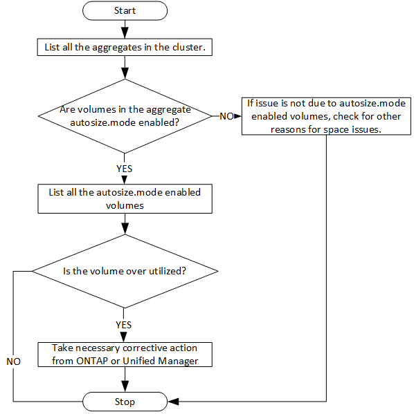

= Determina i problemi di spazio negli aggregati usando le API di Active IQ Unified Manager
:allow-uri-read: 
:icons: font
:imagesdir: ../media/

[role="lead"]
Puoi utilizzare le API del data center in Active IQ Unified Manager per monitorare la disponibilità e l'utilizzo dello spazio nei tuoi volumi. Puoi individuare problemi di spazio nel tuo volume e identificare risorse di storage sovrautilizzate o sottoutilizzate.

Le API del data center per gli aggregati recuperano le informazioni rilevanti sullo spazio disponibile e utilizzato, nonché le impostazioni di efficienza per il risparmio di spazio. Puoi anche filtrare le informazioni recuperate in base ad attributi specifici.

Un metodo per determinare l'eventuale mancanza di spazio nei tuoi aggregati consiste nel verificare se nel tuo ambiente sono presenti volumi con la modalità di dimensionamento automatico abilitata. Dovrai quindi identificare quali volumi sono sovrautilizzati ed eseguire le azioni correttive necessarie.

Il seguente diagramma di flusso illustra il processo di recupero delle informazioni sui volumi con la modalità di dimensionamento automatico abilitata:

Questo flusso presuppone che i cluster siano già stati creati in ONTAP e aggiunti a Unified Manager.

. Recupera la chiave del cluster, a meno che tu non ne conosca già il valore:
+
[cols="3*"]
|===
| Categoria | Verbo HTTP | Percorso 

 a| 
centro dati
 a| 
GET
 a| 
`/datacenter/cluster/clusters`

|===
. Utilizzando la chiave del cluster come parametro di filtro, interroga gli aggregati su quel cluster.
+
[cols="3*"]
|===
| Categoria | Verbo HTTP | Percorso 

 a| 
centro dati
 a| 
GET
 a| 
`/datacenter/storage/aggregates`

|===
. Dalla risposta, analizza l'utilizzo dello spazio da parte degli aggregati e determina quali aggregati presentano problemi di spazio. Per ogni aggregato con problemi di spazio, ottieni la chiave dell'aggregato dallo stesso output JSON.
. Usando ogni chiave dell'aggregato, filtra tutti i volumi che hanno come valore del parametro autosize.mode  `grow.`
+
[cols="3*"]
|===
| Categoria | Verbo HTTP | Percorso 

 a| 
centro dati
 a| 
GET
 a| 
`/datacenter/storage/volumes`

|===
. Analizza quali volumi sono utilizzati eccessivamente.
. Esegui le azioni correttive necessarie, come spostare il volume tra aggregati, per risolvere i problemi di spazio nel tuo volume. Puoi eseguire queste azioni da ONTAP o dall'interfaccia utente web di Unified Manager.

