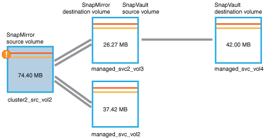

= Identifica il problema ed esegui le azioni correttive per un job di protezione non riuscito in Active IQ Unified Manager
:allow-uri-read: 
:icons: font
:imagesdir: ../media/

[role="lead"]
Esamini il messaggio di errore relativo all'errore del processo nel campo Cause nella pagina Event details e stabilisci che il processo non è riuscito a causa di un errore della copia Snapshot. Passi quindi alla pagina Volume / Health details per raccogliere ulteriori informazioni.

.Prima di iniziare
Devi avere il ruolo di Amministratore dell'applicazione.

Il messaggio di errore visualizzato nel campo Causa nella pagina Dettagli evento contiene il seguente testo relativo al job non riuscito:

[listing]
----
Protection Job Failed. Reason: (Transfer operation for
relationship 'cluster2_src_svm:cluster2_src_vol2->cluster3_dst_svm:
managed_svc2_vol3' ended unsuccessfully. Last error reported by
Data ONTAP: Failed to create Snapshot copy 0426cluster2_src_vol2snap
on volume cluster2_src_svm:cluster2_src_vol2. (CSM: An operation
failed due to an ONC RPC failure.)
Job Details
----
Questo messaggio fornisce le seguenti informazioni:

* L'operazione di backup o mirroring non è stata completata correttamente.
+
Il processo prevedeva una relazione di protezione tra il volume sorgente `cluster2_src_vol2` sul server virtuale `cluster2_src_svm` e il volume di destinazione `managed_svc2_vol3` sul server virtuale denominato `cluster3_dst_svm`.

* Un'operazione di copia Snapshot non è riuscita per `0426cluster2_src_vol2snap` sul volume di origine `cluster2_src_svm:/cluster2_src_vol2`.

In questo scenario, puoi identificare la causa e le potenziali azioni correttive dell'errore del processo. Tuttavia, per risolvere l'errore, devi accedere all'interfaccia utente web di System Manager o ai comandi CLI di ONTAP.

.Passaggi
. Esamina il messaggio di errore e stabilisci che un'operazione di copia Snapshot non è riuscita sul volume di origine, il che indica probabilmente un problema con il volume di origine.
+
Facoltativamente, puoi fare clic sul collegamento *Job Details* alla fine del messaggio di errore, ma ai fini di questo scenario scegli di non farlo.

. Decidi di provare a risolvere l'evento, quindi procedi come segue:
+
.. Fai clic sul pulsante *Assign To* e seleziona *Me* dal menu.
.. Fai clic sul pulsante *Acknowledge* per non continuare a ricevere notifiche di avviso ripetute, se per l'evento erano stati impostati avvisi.
.. Facoltativamente, puoi anche aggiungere note sull'evento.

. Fai clic sul campo *Origine* nel riquadro *Riepilogo* per visualizzare i dettagli relativi al volume di origine.
+
Il campo *Origine* contiene il nome dell'oggetto di origine: in questo caso, il volume su cui è stato pianificato il processo di copia Snapshot.

+
Compare la pagina dei dettagli Volume / Integrità per `cluster2_src_vol2`, che mostra il contenuto della scheda Protezione.

. Osservando il grafico della topologia di protezione, vedi un'icona di errore associata al primo volume nella topologia, che è il volume di origine della relazione di SnapMirror.
+
Nell'icona del volume sorgente sono inoltre visibili delle barre orizzontali che indicano le soglie di avviso e di errore impostate per quel volume.

+

. Posiziona il cursore sull'icona di errore per visualizzare la finestra di dialogo a comparsa con le impostazioni della soglia e vedere che il volume ha superato la soglia di errore, indicando un problema di capacità.
. Fai clic sulla scheda *Capacity*.
+
Informazioni sulla capacità dei display del volume `cluster2_src_vol2`.

. Nel pannello *Capacità*, vedi un'icona di errore nel grafico a barre, che indica nuovamente che la capacità del volume ha superato il livello di soglia impostato per il volume.
. Sotto il grafico della capacità, vedi che l'espansione automatica del volume è disattivata e che sul volume è impostata una garanzia di spazio.
+
Potresti decidere di abilitare l'espansione automatica, ma ai fini di questo scenario decidi di approfondire la questione prima di decidere come risolvere il problema di capacità.

. Scorri verso il basso fino all'elenco *Events* e vedi che sono comparsi gli eventi Protection Job Failed, Volume Days Until Full e Volume Space Full.
. Nell'elenco *Events*, fai clic sull'evento *Volume Space Full* per ottenere maggiori informazioni, dopo aver stabilito che questo evento sembra essere il più rilevante per il tuo problema di capacità.
+
La pagina dei dettagli dell'evento visualizza l'evento Spazio del volume pieno per il volume di origine.

. Nell'area *Riepilogo*, leggi il campo Causa dell'evento: `The full threshold set at 90% is breached. 45.38 MB (95.54%) of 47.50 MB is used`.
. Sotto l'area Riepilogo, vedi le Azioni correttive suggerite.
+
[TIP]
====
Le azioni correttive suggerite vengono visualizzate solo per alcuni eventi, quindi questa sezione non è presente per tutti i tipi di eventi.

====
+
Fai clic sull'elenco delle azioni suggerite che puoi eseguire per risolvere l'evento Spazio del volume esaurito:

+
** Abilita la crescita automatica su questo volume.
** Ridimensiona il volume.
** Abilita ed esegui la deduplicazione su questo volume.
** Abilita ed esegui la compressione su questo volume.

. Decidi di abilitare l'espansione automatica sul volume, ma per farlo devi determinare lo spazio libero sull'aggregate principale e il tasso di crescita corrente del volume:
+
.. Osserva l'aggregato principale, `cluster2_src_aggr1` nel riquadro *Dispositivi correlati*.
+
[TIP]
====
Puoi cliccare sul nome dell'aggregato per ottenere maggiori dettagli sull'aggregato.

====
+
Determini che l'aggregato dispone di spazio sufficiente per abilitare l'espansione automatica del volume.

.. Nella parte superiore della pagina, osserva l'icona che indica un incidente critico e leggi il testo sotto l'icona.
+
Hai stabilito che "Giorni al riempimento: meno di un giorno | Tasso di crescita giornaliero: 5,4%".

. Vai in System Manager o accedi alla CLI di ONTAP per abilitare l' `volume autogrow`opzione.
+
[TIP]
====
Prendi nota dei nomi del volume e dell'aggregato in modo da averli a disposizione quando abiliti l'espansione automatica.

====
. Dopo aver risolto il problema di capacità, torna alla pagina dei dettagli di *Event* in Unified Manager e contrassegna l'evento come risolto.

