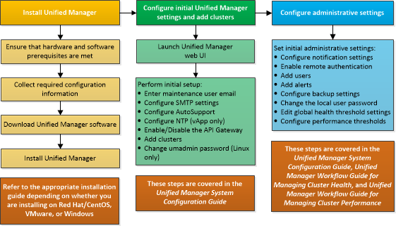

= Visualizza la sequenza di installazione di Active IQ Unified Manager
:allow-uri-read: 
:icons: font
:imagesdir: ../media/

[role="lead"]
Il flusso di lavoro di installazione descrive le attività che devi eseguire prima di poter utilizzare Unified Manager.

Queste sezioni descrivono ciascuno degli elementi illustrati nel flusso di lavoro sottostante.

