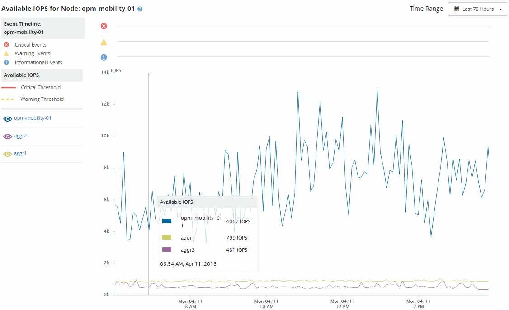

= Visualizza i valori IOPS disponibili per nodi e aggregati in Active IQ Unified Manager
:allow-uri-read: 
:icons: font
:imagesdir: ../media/

[role="lead"]
Puoi monitorare i valori IOPS disponibili per tutti i nodi o per tutti gli aggregati in un cluster, oppure visualizzare i dettagli per un singolo nodo o aggregato.

I valori IOPS disponibili vengono visualizzati nelle pagine Performance Inventory e nei grafici della pagina Performance Explorer per nodi e aggregati. Ad esempio, quando visualizzi un nodo nella pagina Node/Performance Explorer, puoi selezionare il grafico del contatore "`Available IOPS`" dall'elenco per confrontare i valori IOPS disponibili per il nodo e per più aggregati su quel nodo.

Il monitoraggio del contatore IOPS disponibile consente di identificare:

* I nodi o gli aggregati che presentano i valori IOPS disponibili più elevati utili per determinare dove distribuire i carichi di lavoro futuri.
* I nodi o gli aggregati che presentano i valori IOPS disponibili più bassi consentono di identificare le risorse da monitorare per individuare potenziali problemi di prestazioni futuri.
* I volumi e le LUN più trafficati su un aggregate che ha un valore IOPS disponibile ridotto.

