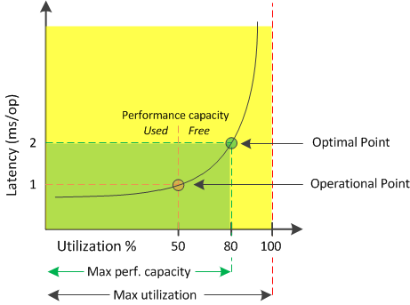

= Comprendi il contatore della capacità di prestazione utilizzata in Active IQ Unified Manager
:allow-uri-read: 
:icons: font
:imagesdir: ../media/

[role="lead"]
Il contatore della capacità prestazionale utilizzata consente di identificare se le prestazioni di un nodo o di un aggregato stanno raggiungendo un punto in cui le prestazioni potrebbero degradarsi se i carichi di lavoro aumentano. Può anche indicare se un nodo o un aggregato è attualmente sovrautilizzato durante periodi di tempo specifici. La capacità prestazionale utilizzata è simile all'utilizzo, ma la prima fornisce maggiori informazioni sulle capacità prestazionali disponibili in una risorsa fisica per un carico di lavoro specifico.

La capacità prestazionale ottimale utilizzata è il punto in cui un nodo o un aggregato presenta utilizzo e latenza (tempo di risposta) ottimali ed è usato in modo efficiente. Nella figura seguente è mostrata una curva di esempio della latenza in funzione dell'utilizzo per un aggregato.

In questo esempio, il _punto operativo_ indica che l'aggregato sta attualmente operando al 50% di utilizzo con latenza di 1,0 ms/op. In base alle statistiche acquisite dall'aggregato, Unified Manager determina che è disponibile ulteriore capacità prestazionale per questo aggregato. In questo esempio, il _punto ottimale_ è identificato come il punto in cui l'aggregato raggiunge l'80% di utilizzo con latenza di 2,0 ms/op. Pertanto, puoi aggiungere altri volumi e LUN a questo aggregato in modo che i tuoi sistemi vengano utilizzati in modo più efficiente.

Il contatore della capacità prestazionale utilizzata dovrebbe essere maggiore del contatore "utilization" perché la capacità prestazionale include anche l'impatto sulla latenza. Ad esempio, se un nodo o un aggregato è utilizzato al 70%, il valore della capacità prestazionale potrebbe essere compreso tra l'80% e il 100%, a seconda del valore della latenza.

In alcuni casi, tuttavia, il contatore di utilizzo potrebbe essere più alto nella pagina Dashboard. Questo è normale perché la dashboard aggiorna i valori correnti del contatore a ogni periodo di raccolta; non visualizza le medie su un periodo di tempo come le altre pagine dell'interfaccia utente di Unified Manager. Il contatore della capacità prestazionale utilizzata è più adatto come indicatore delle prestazioni medie su un periodo di tempo, mentre il contatore di utilizzo è più adatto per determinare l'utilizzo istantaneo di una risorsa.
