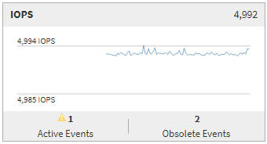

= Consulta la pagina Riepilogo prestazioni in Active IQ Unified Manager
:allow-uri-read: 
:icons: font
:imagesdir: ../media/

[role="lead"]
La pagina Riepilogo visualizza grafici dei contatori che contengono dettagli sugli eventi e sulle prestazioni per ciascun oggetto per il precedente periodo di 72 ore. Questi dati non vengono aggiornati automaticamente, ma sono aggiornati all'ultimo caricamento della pagina. I grafici nella pagina Riepilogo rispondono alla domanda _Devo approfondire ulteriormente?_

[[charts-and-counter-statistics]]
== Grafici e statistiche dei contatori

I grafici riassuntivi forniscono una panoramica rapida, high-level, delle ultime 72 ore e ti aiutano a identificare eventuali problemi che richiedono ulteriori indagini.

Le statistiche dei contatori nella pagina Riepilogo vengono visualizzate in grafici.

Puoi posizionare il cursore sulla linea di tendenza in un grafico per visualizzare i valori del contatore relativi a un determinato momento. I grafici riepilogativi mostrano anche il numero totale di eventi critici e di avviso attivi per le 72 ore precedenti per i seguenti contatori:

* *Latenza*
+
Tempo di risposta medio per tutte le richieste di I/O; espresso in millisecondi per operazione.

+
Visualizzato per tutti i tipi di oggetto.

* *IOPS*
+
Velocità operativa media; espressa in operazioni di input/output al secondo.

+
Visualizzato per tutti i tipi di oggetto.

* *MB/s*
+
throughput medio; espresso in megabyte al secondo.

+
Visualizzato per tutti i tipi di oggetto.

* *Capacità di prestazioni utilizzata*
+
Percentuale della capacità prestazionale utilizzata da un nodo o da un aggregato.

+
Visualizzato solo per nodi e aggregati.

* *Utilizzo*
+
Percentuale di utilizzo degli oggetti per nodi e aggregati o di utilizzo della larghezza di banda per le porte.

+
Visualizzato solo per nodi, aggregati e porte.

Se posizioni il cursore sul conteggio degli eventi attivi, vengono mostrati il tipo e il numero di eventi. Gli eventi critici sono visualizzati in rosso (image:../media/treemapred_png.gif["Icona per TreeMap – colore rosso"]), mentre gli eventi di avviso sono visualizzati in giallo (image:../media/treemapstatus_warning_png.gif["Icona per TreeMap – Stato di avviso"]).

Il numero in alto a destra del grafico nella barra grigia rappresenta il valore medio delle ultime 72 ore. I numeri mostrati in basso e in alto nel grafico a linee di tendenza indicano i valori minimo e massimo delle ultime 72 ore. La barra grigia sotto il grafico contiene il conteggio degli eventi attivi (nuovi e riconosciuti) e degli eventi obsoleti delle ultime 72 ore.

* *Grafico del contatore di latenza*
+
Il grafico del contatore Latenza fornisce una panoramica high-level della latenza dell'oggetto per il periodo precedente di 72 ore. La latenza si riferisce al tempo di risposta medio per tutte le richieste di I/O; espressa in millisecondi per operazione, indica il tempo di servizio, il tempo di attesa o entrambi sperimentati da un pacchetto o blocco di dati nel componente di storage del cluster in esame.

+
*In alto (valore del contatore):* Il numero nell'intestazione mostra la media del precedente periodo di 72 ore.

+
*Parte centrale (grafico delle prestazioni):* Il numero nella parte inferiore del grafico mostra la latenza più bassa e il numero nella parte superiore del grafico mostra la latenza più alta per il periodo precedente di 72 ore. Posiziona il cursore sulla linea di tendenza del grafico per visualizzare il valore di latenza per un'ora specifica.

+
*In basso (eventi):* Passando il mouse sopra, il pop-up visualizza i dettagli degli eventi. Fai clic sul link *Eventi attivi* sotto il grafico per accedere alla pagina Inventario eventi e visualizzare i dettagli completi degli eventi.

* *Grafico del contatore IOPS*
+
Il grafico del contatore IOPS fornisce una panoramica high-level dello stato di salute degli IOPS dell'oggetto per il periodo di 72 ore precedente. Gli IOPS indicano la velocità del sistema storage in numero di operazioni di input/output al secondo.

+
*In alto (valore del contatore):* Il numero nell'intestazione mostra la media del precedente periodo di 72 ore.

+
*Parte centrale (grafico delle prestazioni):* Il numero nella parte inferiore del grafico mostra il valore minimo di IOPS, mentre il numero nella parte superiore mostra il valore massimo di IOPS per le 72 ore precedenti. Posiziona il cursore sulla linea di tendenza del grafico per visualizzare il valore di IOPS per un momento specifico.

+
*In basso (eventi):* Passando il mouse sopra, il pop-up visualizza i dettagli degli eventi. Fai clic sul link *Eventi attivi* sotto il grafico per accedere alla pagina Inventario eventi e visualizzare i dettagli completi degli eventi.

* *Grafico del contatore MB/s*
+
Il grafico del contatore MB/s visualizza le prestazioni dell'oggetto in MB/s e indica la quantità di dati trasferiti da e verso l'oggetto in megabyte al secondo. Il grafico del contatore MB/s fornisce una panoramica high-level dello stato di salute dell'oggetto in MB/s per il precedente periodo di 72 ore.

+
*In alto (valore del contatore):* Il numero nell'intestazione visualizza il numero medio di MB/s per il periodo delle 72 ore precedenti.

+
*Parte centrale (grafico delle prestazioni):* Il valore nella parte inferiore del grafico mostra il numero minimo di MB/s, mentre il valore nella parte superiore mostra il numero massimo di MB/s per le 72 ore precedenti. Posiziona il cursore sulla linea di tendenza del grafico per visualizzare il valore di MB/s per un momento specifico.

+
*In basso (eventi):* Passando il mouse sopra, il pop-up visualizza i dettagli degli eventi. Fai clic sul link *Eventi attivi* sotto il grafico per accedere alla pagina Inventario eventi e visualizzare i dettagli completi degli eventi.

* *Grafico del contatore Performance Capacity Used*
+
Il grafico del contatore "Capacità prestazionale utilizzata" mostra la percentuale di capacità prestazionale consumata dall'oggetto.

+
*In alto (valore del contatore):* Il numero nell'intestazione mostra la capacità prestazionale media utilizzata nel periodo di 72 ore precedenti.

+
*Parte centrale (grafico delle prestazioni):* Il valore nella parte inferiore del grafico mostra la percentuale minima di capacità prestazionale utilizzata, mentre il valore nella parte superiore mostra la percentuale massima di capacità prestazionale utilizzata nelle 72 ore precedenti. Posiziona il cursore sulla linea di tendenza del grafico per visualizzare il valore della capacità prestazionale utilizzata in un momento specifico.

+
*In basso (eventi):* Passando il mouse sopra, il pop-up visualizza i dettagli degli eventi. Fai clic sul link *Eventi attivi* sotto il grafico per accedere alla pagina Inventario eventi e visualizzare i dettagli completi degli eventi.

* *Grafico del contatore di utilizzo*
+
Il grafico del contatore di utilizzo visualizza la percentuale di utilizzo dell'oggetto. Il grafico del contatore di utilizzo fornisce una panoramica high-level della percentuale di utilizzo dell'oggetto o della larghezza di banda per il precedente periodo di 72 ore.

+
*In alto (valore del contatore):* Il numero nell'intestazione mostra la percentuale di utilizzo media per le 72 ore precedenti.

+
*Parte centrale (grafico delle prestazioni):* Il valore nella parte inferiore del grafico mostra la percentuale di utilizzo più bassa, mentre il valore nella parte superiore mostra la percentuale di utilizzo più alta per le 72 ore precedenti. Posiziona il cursore sulla linea di tendenza del grafico per visualizzare il valore di utilizzo per un momento specifico.

+
*In basso (eventi):* Passando il mouse sopra, il pop-up visualizza i dettagli degli eventi. Fai clic sul link *Eventi attivi* sotto il grafico per accedere alla pagina Inventario eventi e visualizzare i dettagli completi degli eventi.

[[events]]
== Eventi

La tabella della cronologia degli eventi, ove applicabile, elenca gli eventi più recenti che si sono verificati su quell'oggetto. Se fai clic sul nome dell'evento, vengono visualizzati i dettagli dell'evento nella pagina Event Details.
