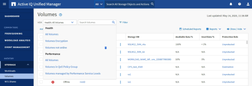

= Capisci la relazione tra visualizzazione e report in Active IQ Unified Manager
:allow-uri-read: 
:icons: font
:imagesdir: ../media/

[role="lead"]
Le viste e le pagine di inventario diventano report quando le scarichi o le pianifichi.

Puoi personalizzare e salvare viste e pagine di inventario per riutilizzarle. Quasi tutto ciò che puoi visualizzare in Unified Manager può essere salvato, riutilizzato, personalizzato, pianificato e condiviso come report.

Nel menu a tendina "Visualizza", gli elementi con l'icona di eliminazione sono visualizzazioni personalizzate esistenti create da te o da un altro utente. Gli elementi senza icona sono visualizzazioni predefinite fornite con Unified Manager. Le visualizzazioni predefinite non possono essere modificate o eliminate.

[NOTE]
====
* Se elimini una visualizzazione personalizzata dall'elenco, elimini anche tutti i file Excel o i report pianificati che utilizzano tale visualizzazione.
* Se modifichi una vista personalizzata, i report che utilizzano tale vista rifletteranno la modifica la volta successiva in cui il report viene generato e inviato tramite e-mail in base alla pianificazione del report. Quando modifichi le viste, assicurati che le modifiche siano compatibili con eventuali personalizzazioni di Excel associate utilizzate per i report. Se necessario, puoi aggiornare il file Excel scaricandolo, apportando le modifiche richieste e caricandolo come nuova personalizzazione di Excel per la vista.

====

Solo gli utenti con il ruolo di Amministratore dell'applicazione o Amministratore dello storage possono visualizzare l'icona di eliminazione, modificare o eliminare una vista oppure modificare o eliminare un report pianificato.
