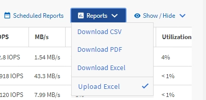

= Usa Excel per personalizzare il tuo report in Active IQ Unified Manager
:allow-uri-read: 
:icons: font
:imagesdir: ../media/

[role="lead"]
Dopo aver salvato la visualizzazione, puoi scaricarla in formato cartella di lavoro di Excel (.xlsx). Quando apri il file Excel, puoi usare le funzionalità avanzate di Excel per personalizzare il report.

.Prima di iniziare
Puoi caricare solo un file Excel Workbook con estensione .xlsx.

Ad esempio, alcune funzionalità avanzate di Excel che puoi utilizzare nel tuo report includono:

* Ordinamento a più colonne
* Filtraggio complesso
* Tabelle pivot
* Grafici

[NOTE]
====
* Il file Excel scaricato utilizza il nome del file predefinito per la vista, non il nome che hai salvato.
+
** Il formato è `<View Area>-<Day>-<Month>-<Year>-<Hour>-<Minute>-<Second>.xlsx.`
** Ad esempio, una vista salvata personalizzata denominata `Volumes-not online` ha un nome file `health-volumes-05-May-2020-19-18-00.xlsx` se salvata in quel giorno e a quell'ora.

* Puoi aggiungere fogli al file Excel, ma non modificare quelli esistenti.
+
** Non modificare i fogli, i dati e le informazioni esistenti. Copia invece i dati in una nuova pagina che creerai.
** Un'eccezione alla regola precedente è che puoi creare formule nella pagina "`data`". Usa le formule della pagina data per creare grafici su nuove pagine.
** Non chiamare un nuovo foglio data o info.

* Se esiste un file Excel personalizzato, accanto alla voce di menu *Reports* > *Upload Excel* è presente un segno di spunta. Quando scarichi il file Excel, viene utilizzata la versione con le personalizzazioni.

====
.Passaggi
. Apri la visualizzazione predefinita, personalizzata o salvata che desideri utilizzare come base per il tuo report.
. Seleziona *Reports* > *Download Excel*.
. Salva il file. Il file viene salvato nella cartella dei download.
. Apri il file salvato in Excel. Non spostare il file in una nuova posizione oppure, se lavori in un'altra posizione, salva il file nella posizione originale utilizzando il nome originale prima di caricarlo.
. Personalizza il file utilizzando le funzionalità di Excel, come ordinamenti complessi, filtri a più livelli, tabelle pivot o grafici. Per ulteriori informazioni, consulta la documentazione di Microsoft® Excel.
. Seleziona *Reports* > *Upload Excel* e seleziona il file che hai modificato. Il file scaricato più di recente viene caricato dalla stessa posizione del file.
. Inviati un report di prova utilizzando la funzionalità *Scheduled Reports*.

