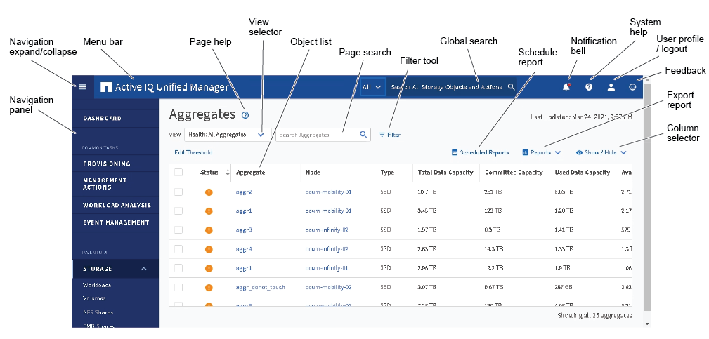
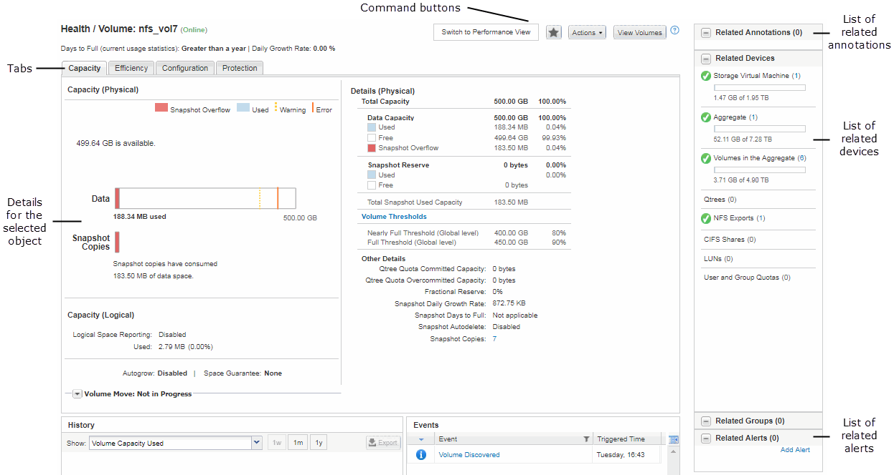

= Layout tipici delle finestre in Active IQ Unified Manager
:allow-uri-read: 
:icons: font
:imagesdir: ../media/

[role="lead"]
Comprendere i layout tipici delle finestre ti aiuta a navigare e a utilizzare Active IQ Unified Manager in modo efficace. La maggior parte delle finestre di Unified Manager è simile a uno di due layout generali: elenco degli oggetti o dettagli. La risoluzione di visualizzazione consigliata è di almeno 1280 x 1024 pixel.

Non tutte le finestre contengono tutti gli elementi presenti nei seguenti diagrammi.

[[object-list-window-layout]]
== Layout della finestra dell'elenco degli oggetti

[[object-details-window-layout]]
== Layout della finestra dei dettagli dell'oggetto

